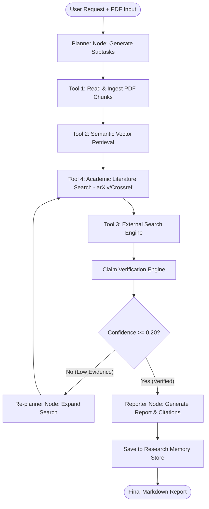

# Agent Workflow Architecture

ResearchPilot operates as a state-machine graph agent that orchestrates multi-step research execution.

## Step Detail Breakdown

### 1. Goal Formulation & Planning
The planner breaks down abstract user prompts into explicit execution subtasks with defined target completion criteria and required tools.

### 2. Document Reading & Chunk Ingestion
PyMuPDF (`fitz`) parses uploaded PDFs page by page, preserving page metadata. Sliding word windows chunk document text, maintaining overlap to retain cross-boundary context.

### 3. Semantic Retrieval & Vector Indexing
Term-frequency and vector cosine-similarity embeddings query the vector store to extract top-k relevant document passages for the query.

### 4. Academic Literature Discovery
Connects directly to public REST APIs for arXiv and Crossref to search peer-reviewed research papers and abstracts.

### 5. Factual Claim Extraction & Verification
Extracts testable research claims, searches internal and external evidence, computes confidence metrics, and assigns verification statuses (`VERIFIED`, `PARTIALLY_SUPPORTED`, `UNSUPPORTED`, `CONFLICTING`, `UNABLE_TO_VERIFY`).

### 6. Bounded Replanning & Retries
If claim evidence or overall confidence falls below acceptable thresholds, the graph engine executes bounded retry iterations to expand search queries before reporting.

### 7. Citation Formatting & Memory Storage
Formats exact, numbered citations mapping claims to page numbers and external URLs, and persists research summaries in SQLite long-term memory.
